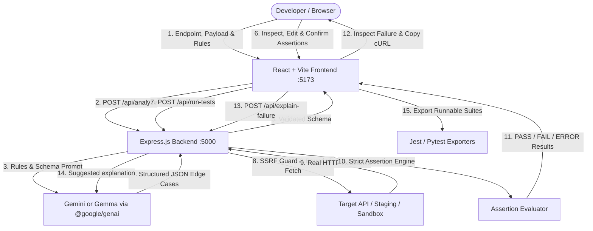

# APIForge ⚡
> **Automated Edge-Case Verification & Regression Testing for Modern APIs**  
> 🏆 **Hacktoberfest Track Winner — Best Use of Gemma 4**

[](https://github.com/INSVikrant54/APIForge/actions/workflows/ci.yml)
[](https://github.com/INSVikrant54/APIForge/releases)
[](LICENSE)

APIForge is a developer workbench for finding API edge cases. Google Gemini or Gemma models propose tests; a **deterministic backend execution engine** sends real HTTP requests and evaluates the results.

Developers provide an API endpoint, a sample payload, and business rules written in plain English — or import an OpenAPI 3.0.x / Swagger 2.0 spec to pre-fill endpoints, request bodies, and expected status codes. APIForge proposes adversarial edge cases across 7 categories, lets developers inspect and fine-tune assertions, executes real HTTP requests with SSRF target checks, and exports regression suites that can be run in CI.

---

## 🌟 Key Features

- **Adversarial edge-case synthesis:** Uses Google Gemini or Gemma models through the official `@google/genai` SDK; the default is `gemini-3.5-flash-lite`.
- **OpenAPI / Swagger import:** Paste or upload an OpenAPI 3.0.x or Swagger 2.0 JSON/YAML spec to pre-fill operations, parameters, sample bodies, and the success status codes declared in the contract. See [OpenAPI / Swagger Import](#-openapi--swagger-import).
- **Named environments & variables:** Switch between `development`, `staging`, and `production`, use `{{baseUrl}}` / `{{apiKey}}` placeholders everywhere, and keep secret values out of storage, history, and exports. See [Environments & Variables](#-environments--variables).
- **Phase 2 CLI:** Create a config, import a spec into a versioned suite file, and run suites from the terminal with text, JSON, JUnit XML, or SARIF output. See [Phase 2 CLI](#-phase-2-cli).
- **Deterministic Verification Engine:** Never relies on LLMs to hallucinate pass/fail results. Real HTTP requests are executed against the target server, and responses are verified by a strict assertion engine.
- **Human-in-the-Loop Developer Control:** Inspect, edit, and fine-tune request payloads, headers, and expected assertions before firing a single request.
- **Review before execution:** Marks ambiguous expectations for confirmation before those tests run.
- **Choose your model:** Use the server-configured key or provide your own Gemini API key; select a supported Gemini/Gemma model or enter a custom model ID.
- **Failure explanation & cURL export:** Optional AI-generated explanations and code suggestions, plus sanitized cURL commands for reproduction.
- **Regression test export:** Export discovered edge cases as **Jest** and **Pytest** test files for your project or CI pipeline.
- **Built-in demo API:** Switch between vulnerable and safe behavior to try the workflow without configuring an external target.
- **SSRF safeguards:** Blocks private and reserved IPv4/IPv6 targets, checks DNS-resolved addresses, and allows only the built-in demo's internal requests.

---

## 📋 Table of Contents
- [The Problem APIForge Solves](#-the-problem-apiforge-solves)
- [Why Deterministic Verification Matters](#-why-deterministic-verification-matters)
- [AI Engine & Flexible Model Architecture](#-ai-engine--flexible-model-architecture)
- [Bring Your Own Key (BYOK)](#-bring-your-own-key-byok)
- [System Architecture](#-system-architecture)
- [OpenAPI / Swagger Import](#-openapi--swagger-import)
- [Environments & Variables](#-environments--variables)
- [7 Edge-Case Test Categories](#-7-edge-case-test-categories)
- [Interactive Sandbox: Safe vs. Vulnerable Mode](#-interactive-sandbox-safe-vs-vulnerable-mode)
- [Developer Control & Custom Assertions](#-developer-control--custom-assertions)
- [Security & SSRF Safeguards](#-security--ssrf-safeguards)
- [Technology Stack](#-technology-stack)
- [Getting Started & Installation](#-getting-started--installation)
- [Environment Variables](#-environment-variables)
- [Running the Application](#-running-the-application)
- [Quickstart](#-quickstart)
- [Phase 2 CLI](#-phase-2-cli)
- [Regression Test Export (Jest & Pytest)](#-regression-test-export-jest--pytest)
- [License](#-license)

---

## 🛑 The Problem APIForge Solves

Modern backend development moves quickly, but comprehensive edge-case testing is often neglected:
- **Unit tests bias toward happy paths:** Developers test what they built the code to do, rarely what an adversary or broken client will send.
- **Manual QA is slow and repetitive:** Writing edge-case payloads for negative numbers, boundary limits, type coercion, and injection patterns takes hours.
- **Production breaks on subtle logic bugs:** Does your checkout endpoint allow `quantity: -5` resulting in negative balance? Does passing a string number `"100"` bypass your integer check? Does omitting a required field cause an unhandled `500 Internal Server Error` with exposed stack traces?
- **Static API specs drift from reality:** Swagger/OpenAPI docs frequently describe how the API *should* work, not how the deployed backend *actually* responds.

APIForge bridges this gap: **you describe your rules in plain English; APIForge discovers where your backend breaks.**

---

## ⚡ Why Deterministic Verification Matters

Generative AI chatbots can spit out lists of hypothetical test scenarios in markdown, but suggestions alone cannot protect production APIs:
1. **Hallucinated Outcomes:** LLMs frequently predict incorrect status codes or assume business logic that your backend doesn't implement.
2. **Untested Hypotheses:** Without executing real HTTP requests, there is zero proof whether an endpoint enforces a rule or silently violates it.
3. **Friction to Action:** Developers must manually convert AI text into Postman collections, cURL commands, or automated test files.

**APIForge’s approach:** AI generates structured hypotheses; **deterministic backend code** tests reality. Pass/fail is based on the received HTTP status and configured response assertions. Response time is recorded for inspection, not used as a pass/fail threshold.

---

## 🧠 AI Engine & Flexible Model Architecture

APIForge uses Google Gemini and Gemma models through the official Google Gen AI SDK (`@google/genai`).

- **Configurable default model:** Set with `GEMMA_MODEL`; the default is `gemini-3.5-flash-lite`.
- **Structured test-plan synthesis:** The selected model analyzes the endpoint method, path, sample request, sample response, and plain-English business rules (e.g. *"Stock must never go negative. Quantity must be a positive integer >= 1. Total price must match quantity * unitPrice"*), then proposes 8–12 edge cases that are validated against the test-plan schema.
- **Failure explanation:** On request, the selected model analyzes a failed assertion and can suggest a remediation. The deterministic runner—not the model—decides pass or fail.
- **Graceful Offline Fallback:** If no Gemini API key is configured, APIForge automatically falls back to a deterministic, pre-configured test suite so developers can evaluate the entire execution engine offline.

---

## 🔑 Bring Your Own Key (BYOK)

APIForge includes native **BYOK (Bring Your Own Key)** support directly within the web workspace:

- **Centralized or Individual:** Run APIForge using the server-side environment key (`GEMINI_API_KEY`), or allow developers and team members to supply their own personal Gemini API key directly from the browser.
- **Model Switching:** Easily switch between supported models without restarting containers:
  - `gemini-3.5-flash-lite` (Default ultra-fast low-latency response model)
  - `gemini-3.5-flash` (High-speed general model)
  - `gemma-4-26b-a4b-it` (High-precision open-weights reasoning)
  - `gemma-4-31b-it` (Larger reasoning model)
  - Custom model ID (for fine-tuned or internal Gemini endpoints)
- **Live Connection Diagnostics:** Test key validity and model access instantly with the built-in **Test Connection** button (`POST /api/verify-key`).
- **Session-scoped key handling:** User-supplied keys are kept in browser session storage and sent to the server in the `x-gemini-api-key` header for AI requests. APIForge does not save custom keys on the server.

---

## 🏗️ System Architecture



---

## 🎯 7 Edge-Case Test Categories

The selected Gemini or Gemma model proposes test scenarios across 7 categories:

| Category | Description | Example Scenario |
| :--- | :--- | :--- |
| 🟢 **Happy Path** | Baseline verification of standard valid inputs | Standard order with valid `quantity` and `productId` expecting `200` or `201`. |
| 🟡 **Missing Field** | Systematically strips required parameters | Omitting `quantity` or `productId` expecting clean `400 Bad Request`. |
| 🟣 **Type Validation** | Injects incompatible data types and type coercion | Sending `"two"` instead of `2`, or boolean `true` for a number. |
| 🔵 **Boundary Tests** | Probes logical and arithmetic thresholds | Testing `quantity: 0`, extreme integers (`MAX_SAFE_INTEGER`), or negative boundary values. |
| 🔴 **Business Rules** | Violates plain-English invariants | Negative quantities (`quantity: -5`) or mismatched total calculations. |
| 🟠 **Malformed Input** | Explores malformed syntax and payload corruption | Empty JSON bodies, missing `Content-Type`, or invalid characters. |
| 🟤 **Inconsistent Data** | Tests semantic contradictions | Total price does not match `quantity * unitPrice`, or currency mismatches. |

---

## 🧪 Interactive Sandbox: Safe vs. Vulnerable Mode

To help teams evaluate the platform immediately without connecting an external backend, APIForge includes a built-in mock Order API (`POST /api/demo/orders`):

```
+---------------------------------------------------------------------------------+
|                               Built-in Demo Endpoint                             |
|                           POST /api/demo/orders                                  |
+---------------------------------------+-----------------------------------------+
|        🔴 Vulnerable Mode (Default)   |             🟢 Safe Mode                |
+---------------------------------------+-----------------------------------------+
| • Intentionally omits validation for  | • Strict defensive validation enabled.  |
|   quantity <= 0.                      | • Rejects non-positive quantities.      |
| • Accepts quantity: -5 and returns    | • Returns HTTP 400 Bad Request with:    |
|   HTTP 201 Created with negative      |   {"error": "Quantity must be greater   |
|   total price (-$4,995.00).           |   than zero"}                           |
| • Fails assertion -> Flags RED!       | • Expected checks pass; review cases stay flagged. |
+---------------------------------------+-----------------------------------------+
```

Use the demo control in the header to switch between the vulnerable and safe demo behavior, then rerun the tests to compare results.

---

## 🛠️ Developer Control & Custom Assertions

APIForge is an interactive developer workbench, not an opaque black box:

1. **Assertion Editing:** Expand any synthesized test card to modify HTTP methods, paths, headers, JSON body, or expected status codes.
2. **Deterministic Assertion Types:** Assertions support:
   - `status`: Status code matching (e.g. `400`, `[200, 201]`)
   - `jsonPath`: Target specific properties in JSON responses (e.g. `body.error`, `body.order.totalPrice`)
   - `operators`: `equals`, `notEquals`, `exists`, `notExists`, `type`, `gt`, `lt`, `contains`
3. **Review uncertain expectations (`requiresReview`):** When a generated expectation needs confirmation, APIForge asks you to review or adjust it before execution.
4. **Choose a target:** Test public HTTP/HTTPS APIs. Private and local network targets are blocked, except for APIForge's built-in demo API.

---

## 📥 OpenAPI / Swagger Import

APIForge can read an **OpenAPI 3.0.x** or **Swagger 2.0** contract supplied as JSON or YAML and turn its operations into test-plan-ready endpoint descriptors. This was the first Phase 1 capability to ship; named environments, variables, and authentication helpers followed in v1.7.0, Postman Collection v2.1 interoperability arrived in v1.8.0, and bounded multi-endpoint batch runs in v1.9.0. Request chaining remains unimplemented.

### Supported scope

- Paste a JSON or YAML document into the workspace (**Import OpenAPI** on the start screen) or choose a `.json`, `.yaml`, or `.yml` file.
- `openapi: 3.0.x` and `swagger: "2.0"` documents are recognized; JSON is parsed first, with a safe YAML subset as the fallback. OpenAPI 3.1 and other versions are rejected with a clear error.
- Only `GET`, `POST`, `PUT`, `PATCH`, and `DELETE` operations are extracted — the methods accepted by the test-plan schema. Other operations (for example `HEAD`, `OPTIONS`, or `TRACE`) are ignored.
- Each endpoint carries `method`, `path`, `summary`, `description`, `operationId`, normalized `parameters`, a `requestBody` descriptor (`required`, `contentType`, `schema`, and a generated `example`), and a ready-to-run `request` (`method`, `path`, `headers`, `body`). Path-level and operation-level parameters are merged; examples honor `example` / `default` hints from the contract.
- `expected.statusCodes` contains only **explicit 2xx responses** declared in the contract. Import pre-fills the request configuration; the model still proposes edge cases, and the deterministic runner still decides pass/fail. Declared 2xx codes are authoritative for `happy_path` cases. If no success code is declared — or the base URL is a template / non-HTTP(S) URL — `requiresReview` is set and the case is left for confirmation instead of inventing a `200`.

### Basic usage

In the web workspace:

1. Click **Import OpenAPI** on the start screen.
2. Paste the spec or choose a file, then click **Read specification**.
3. Select an operation to pre-fill the endpoint, body, and expected status codes, then generate and run the test plan as usual.

The same operation is available over HTTP:

```http
POST /api/openapi/parse
Content-Type: application/json

{ "source": "<the complete JSON or YAML spec as a string>" }
```

A successful response is `{ "success": true, "data": [ ...endpoints ] }`. Malformed or unrecognized input returns `400`, a spec larger than 1 MB returns `413`, and a spec with no supported operations returns `422`. The endpoint is rate limited.

### Bounds and security

- Specs are capped at **1 MiB** of text and at **200 operations** per document; larger inputs are rejected (the API responds `400`), not processed without limit.
- Only local `#/...` JSON-pointer `$ref`s inside the pasted document are resolved. **External references (remote URLs or other files) are never fetched** — they are rejected, as are unresolved refs, unsafe pointer tokens, and refs beyond the depth/node caps. Cyclic refs are bounded rather than followed indefinitely.
- Imported contracts are treated as data only: YAML is parsed with a `core` schema (no custom tags or executable constructs), no script from a spec is executed, and only explicit numeric 2xx codes are used as expected successes.
- A spec's base URL (`servers` / `host`) is captured verbatim, never substituted from variables, and flagged for review when it is a template or not HTTP(S). **Local and private API targets remain blocked** by the SSRF guard, including hostnames that resolve to private ranges; only APIForge's built-in demo API is exempt. A base URL in a spec does not bypass those checks.

---

## 📦 Postman Collection v2.1 Import & Export

v1.8.0 adds Postman interoperability. Choose **Import Postman** on the start screen to paste or upload a Collection v2.1 JSON file, then select one request to pre-fill the endpoint. Requests are also exported from the regression suite's **Postman v2.1** tab alongside Jest and Pytest.

- **Strict version check:** only Collection v2.1 is accepted. A v1.0 collection is rejected with an explicit instruction to re-export as v2.1; unknown versions and non-JSON input get equally clear errors.
- **Bounds:** collections are capped at **1 MiB** and **50 requests**, with per-request header and body limits. Folders are flattened within a depth cap. Oversized input is rejected, not silently truncated.
- **Data only:** Postman `event` scripts are never executed. `{{variable}}` placeholders in URLs, headers, and bodies are preserved and resolved later by the selected environment — the same resolver used by the OpenAPI, CLI, and runner paths. Imported requests are marked for review; no expected status code is invented.
- **Export safety:** generated collections are redacted twice (in the export modal and in the exporter). Literal `Authorization`, `Cookie`, `Set-Cookie`, and `X-Gemini-API-Key` values are dropped; templated values such as `Bearer {{token}}` are kept. Exports carry a `baseUrl` collection variable placeholder and never contain session secrets.

---

## 🧪 Bounded Multi-Endpoint Batch

v1.9.0 lets you select several operations after an OpenAPI import and run them as one batch. A tab per endpoint shows its plan, results, and any error; completed endpoints can be opened in the main workspace.

- **Bounded:** selection is capped at **5 endpoints**. The same endpoint-to-config adapter is used for single imports and batch imports, so the two paths cannot diverge.
- **Paced:** a client-side gate spaces analysis and execution calls to one every six seconds (ten per minute, sliding window). This is additive to the server's existing limiters — none were relaxed. Endpoints run strictly one at a time.
- **Resilient:** a failure in one endpoint is recorded in its tab and the remaining endpoints still run. Navigating away cancels the in-flight batch.
- **Safe:** results are redacted with the selected environment's secret list before they reach the batch view; environment variables and auth helpers apply to every endpoint in the batch. SSRF, timeout clamping, and demo isolation are unchanged.

---

## 🌍 Environments & Variables

v1.6.0 adds the environment slice of Phase 1: named environments (`development`, `staging`, `production`), `{{baseUrl}}` / `{{apiKey}}` style placeholders, and an environment selector in the request panel.

- **One resolver, three surfaces:** `server/utils/environmentResolver.js` is a pure, dependency-free module used by the server runner, the CLI, and the browser client. It normalizes plain values and `{ value, secret }` records, resolves a named environment, and recursively substitutes strings, objects, arrays, paths, headers, and bodies. Substitution is bounded; unknown placeholders stay visible so they can be fixed rather than silently becoming empty strings.
- **Secret handling:** Mark a variable as secret in the UI or with `{ "value": "...", "secret": true }` in a config/suite file. Secrets are used at run time, never written to `localStorage`, and redacted (`[REDACTED]`) from run results, recent-run history, regression exports, cURL output, and CLI text/JSON/JUnit/SARIF reports. Non-secret values are resolved for AI plan generation; secret values are injected only for execution.
- **UI:** Choose an environment from the selector in the request panel and expand **Environment variables** to edit values per environment. Values are session-only and switching environments keeps each environment's values separate.
- **CLI:** `apiforge init --env development,staging,production --secret API_KEY --yes` writes placeholder-only environments into `apiforge.config.json`. `apiforge run suite.json --env staging --secret API_KEY` injects a secret from `process.env.API_KEY`, or use `--secret API_KEY=value`; `--secret` is repeatable. Local config environments are merged into suite environments, with local values taking precedence. Runtime secrets are never written to disk.
- **Server:** `POST /api/run-tests` accepts an `environment` descriptor and applies the same resolver before the existing SSRF guard. Redirect handling is unchanged: redirects are never followed.

v1.7.0 adds per-environment authentication helpers. Choose **None**, **Bearer token**, **API key (header)**, **API key (query parameter)**, or **Basic auth** under Settings → Authentication. Each helper references an environment variable by name; credential values are never typed into the auth panel and are never written to disk. Headers and query parameters are attached at call time in the browser and again (idempotently) on the server, so direct API callers get the same behavior. Credential variables are redacted from run results, history, cURL output, and exports even if they are not flagged as secret. Unsafe header names and missing variables are skipped rather than sending an empty credential.

This is a coherent feature slice, not a claim that all of Phase 1 is complete. The full Phase 1 → 2.0.0 and Phase 2 → 2.1.0 version sequence remains open.

---

## 🛡️ Security & SSRF Safeguards

Because APIForge executes HTTP requests on behalf of users, it applies network and input safeguards:

- **Key handling:** The server-configured `GEMINI_API_KEY` stays on the server. Custom keys are stored in browser session storage and sent in the request header when needed; APIForge does not save them on the server.
- **SSRF target checks (`ssrfGuard.js`):** Rejects private or reserved IPv4/IPv6 targets, including hostnames resolving to restricted addresses. The runner does not follow redirects; 3xx responses are returned for inspection.
- **Sensitive header and variable redaction:** Sensitive headers (`Authorization`, `Cookie`, `x-api-key`, `x-gemini-api-key`) and variables marked `secret` are redacted from logs, cURL outputs, run history, and exported test suites.
- **Request limits:** The configured fetch timeout defaults to 6 seconds and is clamped to 1–30 seconds. Response text returned in results is truncated at 100KB.
- **No assertion-code execution:** Assertions use a fixed set of declarative operators; APIForge does not evaluate user-provided JavaScript or run shell commands.

---

## 💻 Technology Stack

### Frontend
- **React 18** & **Vite 6**
- **Vanilla CSS Design System:** Dark developer console theme (Cold Slate `#1c1c1c`/`#212121`/`#242424`, Molten Ember `#ff6c37` accent, flat structural elevation, Fira Code verification surfaces)
- **Lucide React:** Clean developer tool iconography
- **Native Fetch API:** Streaming and REST communication

### Backend
- **Node.js 20+** & **Express.js (ES Modules)**
- **`@google/genai` (v2.31.0):** Official Google Gen AI SDK for Gemini and Gemma models
- **Deterministic Assertion Evaluator:** Precise status, JSONPath, and arithmetic invariant comparisons
- **SSRF Guard & HTTP Client:** `AbortController` request timeouts and IP/DNS target checks

---

## 🚀 Getting Started & Installation

### Prerequisites
- **Node.js:** v20 or higher locally; CI runs on Node 24 and the production container uses Node 20
- **npm:** v9.0.0 or higher

### 1. Clone the repository
```bash
git clone https://github.com/INSVikrant54/APIForge.git
cd APIForge
```

### 2. Install dependencies
```bash
# Installs root, backend, and frontend dependencies
npm run install:all
```
*(Alternatively, run `npm install` inside both `server/` and `client/` directories)*

---

## 🔑 Environment Variables

Create a `.env` file in the root directory (or in `server/.env`):

```bash
cp .env.example .env
```

Configure your environment settings:
```env
# Your Gemini API Key from Google AI Studio (https://aistudio.google.com/)
GEMINI_API_KEY=your_gemini_api_key_here

# Default AI Model ID (e.g. gemini-3.5-flash-lite, gemma-4-26b-a4b-it)
GEMMA_MODEL=gemini-3.5-flash-lite

# Server Port (Default: 5000)
PORT=5000
```

> **Note:** If `GEMINI_API_KEY` is omitted, APIForge operates automatically in **Predefined Offline Demo Mode**, allowing full offline verification of the built-in Order API.

---

## 🏃 Running the Application

### Start Full Stack (Frontend + Backend)
Starts both the Express API server (port 5000) and the Vite frontend (port 5173):
```bash
npm run dev
```

### Run Backend Only
```bash
npm run dev:server
# Express running on http://localhost:5000
```

### Run Frontend Only
```bash
npm run dev:client
# Vite running on http://localhost:5173
```

---

## 🚀 Quickstart

1. Open **http://localhost:5173** in your browser.
2. **Run the demo:** On the start screen, click **Run the demo**. APIForge loads the built-in Order API and prepares a test plan.
3. **Review tests:** Inspect the generated test cards and adjust payloads or expected status codes if needed.
4. **Execute tests:** Run the selected tests. The demo starts in vulnerable mode, so a negative-quantity scenario should fail.
5. **Inspect the failure:** Open the failing test to compare the expected and actual response. Copy its cURL command to reproduce it, or request an optional AI explanation.
6. **Verify safe mode:** Switch the demo to **Use safe demo** and rerun the tests. Expected checks should pass; cases marked for confirmation remain identified for review.
7. **Export:** Click **Export** to download Jest/Pytest regression suites for CI.

**For your own API:** Choose **Test my API**, enter a public endpoint and rules, then click **Generate Test Plan**. The selected Gemini or Gemma model proposes edge cases across 7 categories. Alternatively, choose **Import OpenAPI** to start from an OpenAPI 3.0.x or Swagger 2.0 JSON/YAML spec and pre-fill operations and expected status codes. Private and local network targets are blocked except for the built-in demo.

---

## 🧰 Phase 2 CLI

The CLI ships as part of **v1.5.0**. It reuses the same deterministic runner as the web workspace, so terminal and CI verdicts match browser results. The npm package is not published yet; run it from a clone:

```bash
npm run cli -- --help
# or
node cli/index.js --help
```

### Create a config

```bash
npm run cli -- init --target https://api.example.com --env staging --yes
```

This writes `apiforge.config.json` with a named environment placeholder. It does not store secret values — use variables in the suite file for secrets.

### Import a spec into a suite

```bash
npm run cli -- import openapi.yaml --out apiforge.suite.json --name "Pets API"
```

Each supported operation becomes a deterministic test in a versioned suite file (`schemaVersion: 1`). Only explicit 2xx codes from the contract become expected statuses; operations without one are marked for review instead of receiving an invented `200`. Operations with unresolved `{pathParam}` templates are also marked for review until a concrete value is supplied.

### Run a suite

```bash
npm run cli -- run apiforge.suite.json --env staging
npm run cli -- run apiforge.suite.json --env staging --ci --format junit --output apiforge-results.xml
```

`{{variable}}` placeholders in request paths, headers, and JSON body strings are substituted from the selected environment. Exit codes are `0` when all tests pass, `1` for failures or unconfirmed review cases, and `2` for configuration, parse, or execution errors.

Supported `--format` values:

| Format | Use |
| :--- | :--- |
| `text` | Default human-readable summary. |
| `json` | Structured machine-readable report on stdout or in `--output`. |
| `junit` | JUnit XML for GitHub Actions, GitLab CI, and Jenkins. |
| `sarif` | SARIF 2.1.0 for the GitHub Security tab. |

`--ci` forces non-interactive output and defaults to `junit` when no format is given.

### GitHub Action wrapper

A local composite action is included at `.github/actions/apiforge`:

```yaml
- uses: ./.github/actions/apiforge
  with:
    suite: apiforge.suite.json
    env: staging
    format: junit
    output: apiforge-results.xml
```

Publishing `apiforge` to npm and a standalone `apiforge/action@v1` repository remain external release tasks; the local CLI and local action are ready to use now.

---

## 📦 Regression Test Export (Jest & Pytest)

APIForge exports ready-to-run regression test files parameterized with the exact edge-case payloads discovered during testing:

### Jest (Supertest / Fetch)
```javascript
const BASE_URL = process.env.TEST_API_BASE_URL || 'http://localhost:5000';

describe('Order API Verification Suite', () => {
  test('[BUSINESS_RULE] Reject negative quantity (-1) -> Expected HTTP 400', async () => {
    const res = await fetch(`${BASE_URL}/api/demo/orders`, {
      method: 'POST',
      headers: { 'Content-Type': 'application/json' },
      body: JSON.stringify({ productId: 101, quantity: -1, unitPrice: 500 })
    });
    expect(res.status).toBe(400);
  });
});
```

### Pytest (Python Requests)
```python
import os, requests, pytest

BASE_URL = os.environ.get("TEST_API_BASE_URL", "http://localhost:5000")

def test_reject_negative_quantity():
    res = requests.post(
        f"{BASE_URL}/api/demo/orders",
        json={"productId": 101, "quantity": -1, "unitPrice": 500}
    )
    assert res.status_code == 400
```

---

## 📄 License

MIT License. See [LICENSE](LICENSE) for details. Built for developers building reliable APIs.