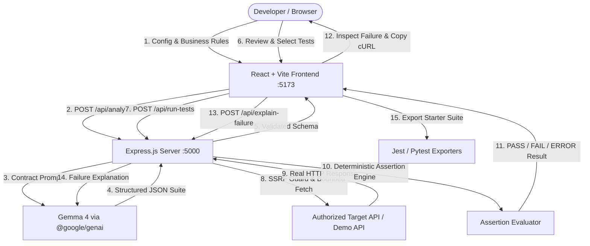

# APIForge ⚡
> **Find the bugs your API doesn't know it has.**

APIForge is an AI-powered API behavior verification and debugging platform. It helps developers discover hidden API defects by analyzing a sample HTTP request, an example response, and plain-English business rules.

Unlike generic AI chatbots that simply suggest hypothetical test cases in text, APIForge:
1. Formulates structured, adversarial edge cases using **Gemma 4** (`gemma-4-26b-a4b-it`) via the official Gemini API SDK (`@google/genai`).
2. Provides an interactive developer review suite to customize payloads and assertions.
3. **Deterministically executes** the selected tests via a secure backend runner with strict SSRF protection.
4. Compares actual HTTP responses with expected contracts using deterministic assertions (never relying on an LLM to hallucinate pass/fail results).
5. Creates reproducible failure reports with one-click **cURL commands**, AI-guided remediation advice, and downloadable **Jest & Pytest regression test suites**.
6. Includes an **Interactive Demo API** with toggleable **Safe Mode** and **Vulnerable Demo Mode** (deliberately exposing a reproducible negative-quantity defect).

---

## 🌟 Table of Contents
- [The Problem APIForge Solves](#the-problem-apiforge-solves)
- [Why Generating Tests Alone Is Insufficient](#why-generating-tests-alone-is-insufficient)
- [How Gemma 4 Is Used](#how-gemma-4-is-used)
- [System Architecture](#system-architecture)
- [7 Edge-Case Test Categories](#7-edge-case-test-categories)
- [Interactive Demo API (Safe vs. Vulnerable)](#interactive-demo-api-safe-vs-vulnerable)
- [Security & SSRF Safeguards](#security--ssrf-safeguards)
- [Technology Stack](#technology-stack)
- [Getting Started & Installation](#getting-started--installation)
- [Environment Variables](#environment-variables)
- [Running the Application](#running-the-application)
- [Interactive Demo Walkthrough](#interactive-demo-walkthrough)
- [Regression Test Export (Jest & Pytest)](#regression-test-export-jest--pytest)
- [Roadmap & Future Improvements](#roadmap--future-improvements)

---

## 🛑 The Problem APIForge Solves
Backend developers, hackathon teams, and students often build REST APIs without complete OpenAPI specifications or end-to-end regression test suites. Manual unit testing typically exercises happy paths and obvious boundaries, while subtle edge cases remain undiscovered:
- Does your order API allow negative quantities or prices?
- Does missing a required field trigger a clean `400 Bad Request` or an unhandled `500 Internal Server Error` with stack traces?
- Do string numbers bypass numeric validation?
- Does the declared total price match quantity multiplied by unit price?

Writing comprehensive edge cases manually is tedious, and static documentation frequently falls out of sync with actual endpoint behavior.

---

## ⚡ Why Generating Tests Alone Is Insufficient
Generative AI chatbots can spit out lists of plausible test cases, but text recommendations alone have critical shortcomings:
1. **Hallucinated Outcomes:** LLMs frequently predict incorrect status codes or assume business logic that the API does not implement.
2. **Untested Assumptions:** Without real execution, there is zero proof whether an endpoint actually enforces a rule or silently violates it.
3. **Execution Friction:** Developers must manually convert AI text into Postman collections, cURL commands, or test files.

**APIForge’s Philosophy:** AI generates structured hypotheses; **deterministic backend code** verifies reality. Pass or fail decisions are never left to generative models.

---

## 🧠 How Gemma 4 Is Used
APIForge utilizes **Gemma 4** (`gemma-4-26b-a4b-it`) through the Gemini API using the official Google Gen AI SDK (`@google/genai`).

- **Configurable Model:** Configured via `GEMMA_MODEL` (defaults to `gemma-4-26b-a4b-it`).
- **Structured Test Plan Generation:** Gemma analyzes the endpoint method, path, sample request, sample response, and plain-English business rules ("Quantity must be greater than zero", "Total price must equal quantity * unit price"), producing 8–12 structured edge cases with strict JSON schema validation.
- **AI Failure Diagnosis:** When a real HTTP test fails, Gemma analyzes the confirmed contract, actual status code, response body, and failed assertion to formulate concrete remediation guidance and code snippets.
- **Graceful Offline Fallback:** If `GEMINI_API_KEY` is not present, the app gracefully loads a predefined, deterministic demo test suite, clearly labelled so developers can evaluate the entire testing and execution workflow offline.

---

## 🏗️ System Architecture



---

## 🎯 7 Edge-Case Test Categories
Gemma 4 produces a balanced suite across 7 key testing dimensions:
1. **Happy Path:** Normal valid requests expecting success (`200` / `201`).
2. **Missing Field:** Systematically removes required properties (e.g. omitting `quantity` or `productId`).
3. **Type Validation:** Injects incompatible data types (e.g. string `"two"` for a number).
4. **Boundary Tests:** Tests logical limit values (e.g. `quantity: 0`, `quantity: 1`, high values).
5. **Business Rule Tests:** Adversarial payloads violating explicit business rules (e.g. `quantity: -1`, negative price).
6. **Malformed Input:** Tests empty JSON bodies, malformed syntax, or missing content types.
7. **Inconsistent Data:** Submits conflicting values (e.g. declared `totalPrice` does not match `quantity * unitPrice`).

---

## 🧪 Interactive Demo API (Safe vs. Vulnerable)
The server bundles a dedicated mock order endpoint (`POST /api/demo/orders`) with two controlled modes:
- **Vulnerable Demo Mode (Default):** Deliberately bypasses positive-quantity validation. When submitting `quantity: -1`, the endpoint returns `201 Created` with a negative total! APIForge flags this as a **FAIL**, exposing the bug.
- **Safe Mode:** Server-side validation is active. Non-positive quantities are rejected with `400 Bad Request`, causing the test to **PASS**.

You can toggle between modes instantly using the mode switch in the header.

---

## 🛡️ Security & SSRF Safeguards
APIForge executes HTTP requests on behalf of the developer. Security is enforced through:
- **Zero Client-Side Secrets:** `GEMINI_API_KEY` is loaded exclusively on the Node.js server via `process.env`.
- **SSRF Guard (`ssrfGuard.js`):** Blocks outbound requests to private IP ranges (`127.0.0.0/8`, `10.0.0.0/8`, `172.16.0.0/12`, `192.168.0.0/16`) and cloud instance metadata (`169.254.169.254`), with explicit allowance only for internal `/api/demo/*` routes.
- **Header Redaction:** Sensitive headers (`Authorization`, `Cookie`, `x-api-key`) are redacted in logs, cURL commands, and exported tests.
- **Execution Limits:** Strict request timeout (default 6,000ms) and response body truncation (100KB limit).
- **Deterministic Assertion Sandbox:** No arbitrary shell commands or untrusted AI-generated scripts are executed on the server.

---

## 💻 Technology Stack

### Frontend
- **React 18** & **Vite 6**
- **Vanilla CSS Design System:** Custom dark SaaS developer theme (Navy/Charcoal, electric blue accents, glowing status indicators)
- **Lucide React:** Consistent developer-tool iconography
- **Native Fetch API:** Clean API communication

### Backend
- **Node.js 20+** & **Express.js (ES Modules)**
- **`@google/genai` (v2.31.0):** Official Google Gen AI SDK for Gemma 4
- **Deterministic Assertion Engine:** Strict JSON path, type, and range comparisons
- **Native Fetch & AbortController:** Bounded HTTP client

---

## 🚀 Getting Started & Installation

### Prerequisites
- **Node.js:** v18.0.0 or later (tested on Node v20/v26)
- **npm:** v9.0.0 or later

### 1. Clone the repository
```bash
git clone https://github.com/INSVikrant54/APIForge.git
cd APIForge
```

### 2. Install dependencies
```bash
# Install root, server, and client dependencies
npm run install:all
```
*(Or manually run `npm install` in root, `server/`, and `client/`)*

---

## 🔑 Environment Variables
Create a `.env` file in the root directory (or in `server/.env`):

```bash
# Copy the example file
cp .env.example .env
```

Edit `.env` with your settings:
```env
# Your Gemini API Key from Google AI Studio (https://aistudio.google.com/)
GEMINI_API_KEY=your_actual_gemini_api_key_here

# Gemma 4 Model ID on Gemini API
GEMMA_MODEL=gemma-4-26b-a4b-it

# Server Port (Default: 5000)
PORT=5000
```
> **Note:** If no `GEMINI_API_KEY` is provided, APIForge runs seamlessly in **Predefined Offline Demo Mode**, allowing full verification of the built-in Order API.

---

## 🏃 Running the Application

### Development Mode (Both Frontend & Backend)
Run both the Express server (port 5000) and Vite frontend (port 5173) concurrently:
```bash
npm run dev
```

### Running Backend Only
```bash
npm run dev:server
# Server runs at http://localhost:5000
```

### Running Frontend Only
```bash
npm run dev:client
# Frontend runs at http://localhost:5173
```

### Running Automated Backend Tests
```bash
npm test --prefix server
```

---

## 🎮 Interactive Demo Walkthrough
Follow this 2-minute walkthrough to see APIForge detect a real bug:

1. Open **http://localhost:5173** in your browser.
2. In the top header, confirm that **Vulnerable Demo Mode** is selected.
3. Click **"Try Interactive Demo"** (or click **"⚡ Generate Test Plan"**).
4. Gemma 4 generates 8 edge-case test cases. Notice scenario **`demo-004: Business Rule / Defect Trigger: Negative quantity (-1)`**.
5. Click **"▶ Run Selected Tests"**.
6. **Observe the Failure:**
   - 7 tests pass.
   - Scenario `demo-004` **FAILS** with status `FAIL (HTTP 201 instead of expected HTTP 400)`.
7. Click **"Inspect Bug"** on the failed card:
   - View the side-by-side discrepancy (Server created an order with `quantity: -1` and `totalPrice: -500`).
   - Click **"Copy cURL"** to reproduce the bug directly in your terminal.
   - Click **"Generate Fix Suggestion"** to receive Gemma 4's remediation advice and code fix.
8. **Verify the Fix:**
   - Toggle the header button to **Safe Mode Active**.
   - Click **"Run Selected Tests"** again.
   - **All 8 tests now PASS!**
9. Click **"Export Regression Tests"** to copy or download ready-to-run Jest or Pytest test files.

---

## 📦 Regression Test Export (Jest & Pytest)
APIForge exports reproducible test suites with parameterized test cases:

### Jest (JavaScript) Example
```javascript
const BASE_URL = process.env.TEST_API_BASE_URL || 'http://localhost:5000';

describe('Order API Verification Suite', () => {
  test('[BUSINESS_RULE] Reject negative quantity (-1) -> Expected HTTP 400', async () => {
    const res = await fetch(`${BASE_URL}/api/demo/orders`, {
      method: 'POST',
      headers: { 'Content-Type': 'application/json' },
      body: JSON.stringify({ productId: 101, quantity: -1, unitPrice: 500 })
    });
    expect(res.status).toBe(400);
  });
});
```

### Pytest (Python) Example
```python
import os, requests, pytest

BASE_URL = os.environ.get("TEST_API_BASE_URL", "http://localhost:5000")

def test_negative_quantity_rejected():
    res = requests.post(
        f"{BASE_URL}/api/demo/orders",
        json={"productId": 101, "quantity": -1, "unitPrice": 500}
    )
    assert res.status_code == 400
```

---

## 🔮 Roadmap & Future Improvements
- [ ] OpenAPI / Swagger 3.0 specification import
- [ ] Postman Collection export
- [ ] CI/CD GitHub Action runner
- [ ] Response latency SLA benchmarking
- [ ] Multi-step chained API workflow verification

---

## 📄 License
MIT License. Built for the Google AI Hackathon.