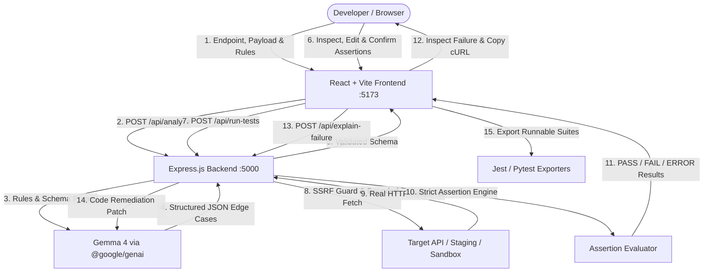

# APIForge ⚡
> **Automated Edge-Case Verification & Regression Testing for Modern APIs**

APIForge is a developer platform that automatically discovers hidden API defects by combining **Gemma 4** (`gemma-4-26b-a4b-it`) AI reasoning with a **deterministic backend execution engine**. 

Developers provide an API endpoint, a sample payload, and business rules written in plain English. APIForge synthesizes adversarial edge cases across 7 categories, gives developers complete control to inspect and fine-tune assertions, executes real HTTP requests through a security-hardened SSRF sandbox, and exports verified regression suites directly into CI/CD pipelines.

---

## 🌟 Key Features

- **Adversarial Edge-Case Synthesis:** Powered by Google's open-weights **Gemma 4** (`gemma-4-26b-a4b-it`) through the official `@google/genai` SDK.
- **Deterministic Verification Engine:** Never relies on LLMs to hallucinate pass/fail results. Real HTTP requests are executed against the target server, and responses are verified by a strict assertion engine.
- **Human-in-the-Loop Developer Control:** Inspect, edit, and fine-tune request payloads, headers, and expected assertions before firing a single request.
- **Contract Ambiguity Detection:** Flags under-specified contract behaviors with a `Requires Review` badge before execution.
- **Bring Your Own Key (BYOK) & Multi-Model Support:** Configure your own Gemini API key or switch between `gemma-4-26b-a4b-it`, `gemma-4-31b-it`, `gemini-3.8-flash`, `gemini-2.5-flash`, or custom models directly in the UI.
- **AI Failure Diagnostics & cURL Export:** One-click root-cause analysis, actionable code remediation patches, and sanitized reproduction cURLs.
- **One-Click CI/CD Regression Export:** Export discovered edge cases into production-ready **Jest (Supertest)** and **Pytest** test suites.
- **Built-in Training & Verification Sandbox:** Interactive mock Order API with toggleable **Safe Mode** and **Vulnerable Mode** for rapid evaluation and testing.
- **Enterprise SSRF Protection:** Prevents server-side request forgery by blocking private IP ranges (`127.0.0.0/8`, `10.0.0.0/8`, `172.16.0.0/12`, `192.168.0.0/16`) and cloud metadata services (`169.254.169.254`).

---

## 📋 Table of Contents
- [The Problem APIForge Solves](#-the-problem-apiforge-solves)
- [Why Deterministic Verification Matters](#-why-deterministic-verification-matters)
- [AI Engine & Flexible Model Architecture](#-ai-engine--flexible-model-architecture)
- [Bring Your Own Key (BYOK)](#-bring-your-own-key-byok)
- [System Architecture](#-system-architecture)
- [7 Edge-Case Test Categories](#-7-edge-case-test-categories)
- [Interactive Sandbox: Safe vs. Vulnerable Mode](#-interactive-sandbox-safe-vs-vulnerable-mode)
- [Developer Control & Custom Assertions](#-developer-control--custom-assertions)
- [Security & SSRF Safeguards](#-security--ssrf-safeguards)
- [Technology Stack](#-technology-stack)
- [Getting Started & Installation](#-getting-started--installation)
- [Environment Variables](#-environment-variables)
- [Running the Application](#-running-the-application)
- [Developer Quickstart](#-developer-quickstart)
- [Regression Test Export (Jest & Pytest)](#-regression-test-export-jest--pytest)
- [Roadmap](#-roadmap)
- [License](#-license)

---

## 🛑 The Problem APIForge Solves

Modern backend development moves quickly, but comprehensive edge-case testing is often neglected:
- **Unit tests bias toward happy paths:** Developers test what they built the code to do, rarely what an adversary or broken client will send.
- **Manual QA is slow and repetitive:** Writing edge-case payloads for negative numbers, boundary limits, type coercion, and injection patterns takes hours.
- **Production breaks on subtle logic bugs:** Does your checkout endpoint allow `quantity: -5` resulting in negative balance? Does passing a string number `"100"` bypass your integer check? Does omitting a required field cause an unhandled `500 Internal Server Error` with exposed stack traces?
- **Static API specs drift from reality:** Swagger/OpenAPI docs frequently describe how the API *should* work, not how the deployed backend *actually* responds.

APIForge bridges this gap: **you describe your rules in plain English; APIForge discovers where your backend breaks.**

---

## ⚡ Why Deterministic Verification Matters

Generative AI chatbots can spit out lists of hypothetical test scenarios in markdown, but suggestions alone cannot protect production APIs:
1. **Hallucinated Outcomes:** LLMs frequently predict incorrect status codes or assume business logic that your backend doesn't implement.
2. **Untested Hypotheses:** Without executing real HTTP requests, there is zero proof whether an endpoint enforces a rule or silently violates it.
3. **Friction to Action:** Developers must manually convert AI text into Postman collections, cURL commands, or automated test files.

**APIForge’s Philosophy:** AI generates structured hypotheses; **deterministic backend code** tests reality. Pass or fail decisions are always evaluated against real HTTP status codes, headers, response times, and JSON payloads.

---

## 🧠 AI Engine & Flexible Model Architecture

APIForge utilizes Google's state-of-the-art open-weights reasoning model **Gemma 4** (`gemma-4-26b-a4b-it`) via the official Google Gen AI SDK (`@google/genai`).

- **Configurable Default Model:** Configured via the `GEMMA_MODEL` environment variable (defaults to `gemma-4-26b-a4b-it`).
- **Structured Test Plan Synthesis:** Gemma analyzes the endpoint method, path, sample request, sample response, and plain-English business rules (e.g. *"Stock must never go negative. Quantity must be a positive integer >= 1. Total price must match quantity * unitPrice"*), producing 8–12 structured edge cases with strict JSON schema validation.
- **AI Root-Cause Diagnosis:** When an HTTP request fails an assertion, Gemma analyzes the confirmed contract, the actual status code, the response body, and the failed assertion to formulate concrete remediation patches.
- **Graceful Offline Fallback:** If no Gemini API key is configured, APIForge automatically falls back to a deterministic, pre-configured test suite so developers can evaluate the entire execution engine offline.

---

## 🔑 Bring Your Own Key (BYOK)

APIForge includes native **BYOK (Bring Your Own Key)** support directly within the web workspace:

- **Centralized or Individual:** Run APIForge using the server-side environment key (`GEMINI_API_KEY`), or allow developers and team members to supply their own personal Gemini API key directly from the browser.
- **Model Switching:** Easily switch between supported models without restarting containers:
  - `gemma-4-26b-a4b-it` (Default high-precision reasoning)
  - `gemma-4-31b-it` (Larger reasoning model)
  - `gemini-3.8-flash` (High-speed general model)
  - `gemini-2.5-flash` (Fastest response model — low latency)
  - Custom model ID (for fine-tuned or internal Gemini endpoints)
- **Live Connection Diagnostics:** Test key validity and model access instantly with the built-in **Test Connection** button (`POST /api/verify-key`).
- **In-Memory Security:** User-supplied keys are maintained strictly in client memory and transmitted via runtime HTTP headers (`x-gemini-api-key`). Custom keys are never written to disk, databases, or log files.

---

## 🏗️ System Architecture



---

## 🎯 7 Edge-Case Test Categories

Gemma 4 generates balanced, adversarial test scenarios across 7 specialized domains:

| Category | Description | Example Scenario |
| :--- | :--- | :--- |
| 🟢 **Happy Path** | Baseline verification of standard valid inputs | Standard order with valid `quantity` and `productId` expecting `200` or `201`. |
| 🟡 **Missing Field** | Systematically strips required parameters | Omitting `quantity` or `productId` expecting clean `400 Bad Request`. |
| 🟣 **Type Validation** | Injects incompatible data types and type coercion | Sending `"two"` instead of `2`, or boolean `true` for a number. |
| 🔵 **Boundary Tests** | Probes logical and arithmetic thresholds | Testing `quantity: 0`, extreme integers (`MAX_SAFE_INTEGER`), or negative boundary values. |
| 🔴 **Business Rules** | Violates plain-English invariants | Negative quantities (`quantity: -5`) or mismatched total calculations. |
| 🟠 **Malformed Input** | Explores malformed syntax and payload corruption | Empty JSON bodies, missing `Content-Type`, or invalid characters. |
| 🟤 **Inconsistent Data** | Tests semantic contradictions | Total price does not match `quantity * unitPrice`, or currency mismatches. |

---

## 🧪 Interactive Sandbox: Safe vs. Vulnerable Mode

To help teams evaluate the platform immediately without connecting an external backend, APIForge includes a built-in mock Order API (`POST /api/demo/orders`):

```
+---------------------------------------------------------------------------------+
|                               Built-in Demo Endpoint                             |
|                           POST /api/demo/orders                                  |
+---------------------------------------+-----------------------------------------+
|        🔴 Vulnerable Mode (Default)   |             🟢 Safe Mode                |
+---------------------------------------+-----------------------------------------+
| • Intentionally omits validation for  | • Strict defensive validation enabled.  |
|   quantity <= 0.                      | • Rejects non-positive quantities.      |
| • Accepts quantity: -5 and returns    | • Returns HTTP 400 Bad Request with:    |
|   HTTP 201 Created with negative      |   {"error": "Quantity must be greater   |
|   total price (-$4,995.00).           |   than zero"}                           |
| • Fails assertion -> Flags RED!       | • Passes assertion -> 100% GREEN!       |
+---------------------------------------+-----------------------------------------+
```

Toggle between modes instantly using the switch in the header to observe how APIForge catches the defect and verifies the fix.

---

## 🛠️ Developer Control & Custom Assertions

APIForge is an interactive developer workbench, not an opaque black box:

1. **Assertion Editing:** Expand any synthesized test card to modify HTTP methods, paths, headers, JSON body, or expected status codes.
2. **Deterministic Assertion Types:** Assertions support:
   - `status`: Status code matching (e.g. `400`, `[200, 201]`)
   - `jsonPath`: Target specific properties in JSON responses (e.g. `body.error`, `body.order.totalPrice`)
   - `operators`: `equals`, `notEquals`, `exists`, `notExists`, `type`, `gt`, `lt`, `contains`
3. **Contract Ambiguity Detection (`requiresReview`):** If Gemma detects that your plain-English rules did not specify behavior for an edge case, it flags the test card with an amber review badge so you can confirm or adjust the assertion before executing.
4. **Target Any API:** Point APIForge to any local server, staging environment, or public REST endpoint.

---

## 🛡️ Security & SSRF Safeguards

Because APIForge executes HTTP requests on behalf of users, strict security measures are implemented at the networking layer:

- **Zero Client-Side Secrets:** `GEMINI_API_KEY` is kept exclusively on the server. Custom BYOK keys are held in client state and passed only via memory headers.
- **SSRF Guard (`ssrfGuard.js`):** Blocks outbound requests targeting private IP subnets (`127.0.0.0/8`, `10.0.0.0/8`, `172.16.0.0/12`, `192.168.0.0/16`) and cloud instance metadata endpoints (`169.254.169.254`), with an explicit allowlist only for internal sandbox routes (`/api/demo/*`).
- **Sensitive Header Redaction:** Sensitive headers (`Authorization`, `Cookie`, `x-api-key`, `x-gemini-api-key`) are redacted from logs, cURL outputs, and exported test suites.
- **Resource Limits:** Enforces a 6,000ms request timeout and truncates response bodies at 100KB to prevent memory exhaustion.
- **No Arbitrary Code Execution:** The assertion engine runs in a restricted JavaScript sandbox—no dynamic `eval()` or untrusted shell execution.

---

## 💻 Technology Stack

### Frontend
- **React 18** & **Vite 6**
- **Vanilla CSS Design System:** Modern dark developer console theme (Charcoal/Navy, electric cyan accents, subtle glassmorphism)
- **Lucide React:** Clean developer tool iconography
- **Native Fetch API:** Streaming and REST communication

### Backend
- **Node.js 20+** & **Express.js (ES Modules)**
- **`@google/genai` (v2.31.0):** Official Google Gen AI SDK for Gemma 4 & Gemini
- **Deterministic Assertion Evaluator:** Precise status, JSONPath, and arithmetic invariant comparisons
- **SSRF Guard & Bounded HTTP Client:** `AbortController` timeouts and IP range filters

---

## 🚀 Getting Started & Installation

### Prerequisites
- **Node.js:** v18.0.0 or higher (v20+ recommended)
- **npm:** v9.0.0 or higher

### 1. Clone the repository
```bash
git clone https://github.com/INSVikrant54/APIForge.git
cd APIForge
```

### 2. Install dependencies
```bash
# Installs root, backend, and frontend dependencies
npm run install:all
```
*(Alternatively, run `npm install` inside both `server/` and `client/` directories)*

---

## 🔑 Environment Variables

Create a `.env` file in the root directory (or in `server/.env`):

```bash
cp .env.example .env
```

Configure your environment settings:
```env
# Your Gemini API Key from Google AI Studio (https://aistudio.google.com/)
GEMINI_API_KEY=your_gemini_api_key_here

# Gemma 4 Model ID
GEMMA_MODEL=gemma-4-26b-a4b-it

# Server Port (Default: 5000)
PORT=5000
```

> **Note:** If `GEMINI_API_KEY` is omitted, APIForge operates automatically in **Predefined Offline Demo Mode**, allowing full offline verification of the built-in Order API.

---

## 🏃 Running the Application

### Start Full Stack (Frontend + Backend)
Starts both the Express API server (port 5000) and the Vite frontend (port 5173):
```bash
npm run dev
```

### Run Backend Only
```bash
npm run dev:server
# Express running on http://localhost:5000
```

### Run Frontend Only
```bash
npm run dev:client
# Vite running on http://localhost:5173
```

---

## 📖 Developer Quickstart

1. Open **http://localhost:5173** in your browser.
2. **Configure AI (Optional):** Click the **Gemma 4** badge in the top navigation to switch models or verify your API key connection.
3. **Load a Contract:** Click **"Load Demo Preset"** in the left panel to populate the sample Order API contract, or input your own API endpoint.
4. **Define Plain-English Rules:** Review the business rules (e.g., *"Stock must never go negative. Quantity must be a positive integer >= 1. Total price must match quantity * unitPrice"*).
5. **Synthesize Edge Cases:** Click **"⚡ Synthesize Edge Cases"**. Gemma 4 generates 8–12 structured edge cases across the 7 categories.
6. **Review Assertions:** Inspect the generated test cards. Modify payloads or expected status codes if needed.
7. **Execute Tests:** Ensure the demo toggle is on **Vulnerable Mode** and click **"▶ Run All Assertions"**.
8. **Catch the Bug:** Observe scenario `demo-004` (Negative quantity) **FAIL**. The server returned `201 Created` with a negative total balance instead of the expected `400 Bad Request`.
9. **Inspect & Fix:**
   - Click **"Inspect Bug"** to view the diff between expected and actual response.
   - Click **"Copy cURL"** to reproduce the defect in your terminal.
   - Click **"Generate AI Fix"** for a concrete code patch.
10. **Verify Safe Mode:** Toggle the top switch to **Safe Mode Active** and click **"Run All Assertions"** again. All tests turn **100% GREEN**.
11. **Export:** Click **"Export Regression Suite"** to download executable test suites for your CI pipeline.

---

## 📦 Regression Test Export (Jest & Pytest)

APIForge exports ready-to-run regression test files parameterized with the exact edge-case payloads discovered during testing:

### Jest (Supertest / Fetch)
```javascript
const BASE_URL = process.env.TEST_API_BASE_URL || 'http://localhost:5000';

describe('Order API Verification Suite', () => {
  test('[BUSINESS_RULE] Reject negative quantity (-1) -> Expected HTTP 400', async () => {
    const res = await fetch(`${BASE_URL}/api/demo/orders`, {
      method: 'POST',
      headers: { 'Content-Type': 'application/json' },
      body: JSON.stringify({ productId: 101, quantity: -1, unitPrice: 500 })
    });
    expect(res.status).toBe(400);
  });
});
```

### Pytest (Python Requests)
```python
import os, requests, pytest

BASE_URL = os.environ.get("TEST_API_BASE_URL", "http://localhost:5000")

def test_reject_negative_quantity():
    res = requests.post(
        f"{BASE_URL}/api/demo/orders",
        json={"productId": 101, "quantity": -1, "unitPrice": 500}
    )
    assert res.status_code == 400
```

---

## 🔮 Roadmap

- [ ] **OpenAPI / Swagger 3.0 Import:** Upload JSON/YAML API specifications directly.
- [ ] **Postman Collection Export:** Export test suites directly as Postman Collection v2.1 files.
- [ ] **GitHub Actions CI/CD Integration:** Official GitHub Action to run APIForge assertions in pull requests.
- [ ] **Response Latency SLA Benchmarking:** p95 and p99 response time threshold verification.
- [ ] **Multi-Step State Workflows:** Chained requests verifying multi-endpoint transaction lifecycles.

---

## 📄 License

MIT License. See [LICENSE](LICENSE) for details. Built for developers building reliable APIs.